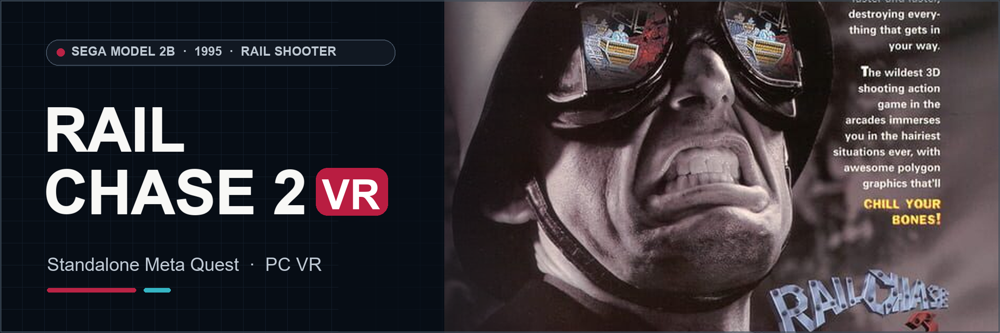

# Rail Chase 2 VR
### Sega Model 2B Arcade Rail Shooter · Standalone Meta Quest & PC VR

**The first public build is being prepared. There is no download here yet.**

**[🌐 VR4ALL — Standalone VR Mod Installer](https://github.com/vr4all-standalone/vr4all-standalone)**  
**[☕ Donate to VR4ALL](https://ko-fi.com/vr4all)**

---

## The port

Rail Chase 2 VR brings Sega's original ride-on rail shooter into stereo VR with head tracking and tracked guns. It runs locally on Quest 3/3S; a Windows OpenXR build is also being prepared. The original game's routes, audio and cabinet logic come from your own game data.

Quest 3S gameplay and audio have been observed in development. Both native player inputs, original targeting artwork, optional custom reticles and the VR4ALL settings menu are implemented. Performance, the latest presentation changes and longer play sessions are still under review.

## Your game files

Bring your own **Rail Chase 2 Revision A** `rchase2.zip` with all **23 required payloads**. If those files are split, also provide `segabill.zip` for the billboard firmware. Older 21-file sets are incomplete. No CHD is required. No original game files are included in this repository or future software downloads.

## When it releases

The planned release will provide a standalone Quest APK, a Windows OpenXR package, complete corresponding source and checksums. VR4ALL will help transfer your verified game files and install the port. Download links and exact setup steps will appear here with the release.

## Development notes

The Quest app name is **Rail Chase 2 - VR4ALL**. Quest 3S gameplay has been observed; Quest 3 and Windows OpenXR physical play, performance and longer routes still need checking. This is an independent fan project, not affiliated with Sega or Meta.

[Original poster and banner attribution](docs/github/ARTWORK.md)
